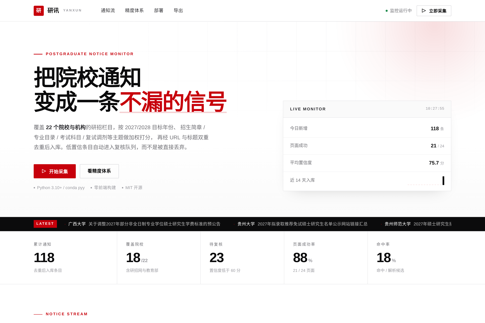
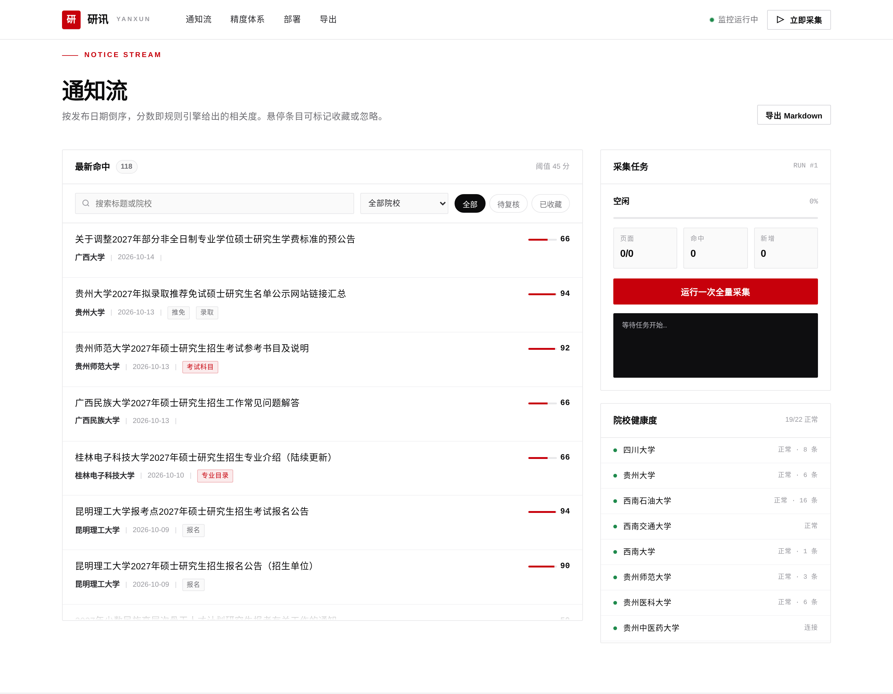
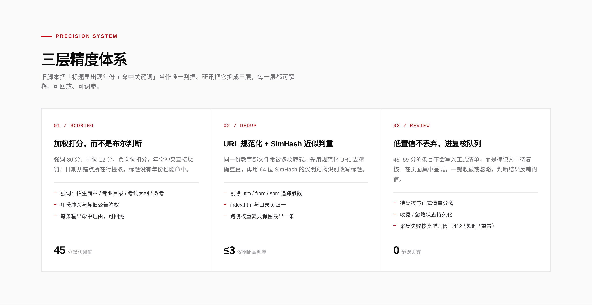

<div align="center">

# 研讯 · YanXun

**面向考研的院校通知监控平台** —— 22 个研招源，一条不漏。

[](./tests)
[](./requirements.txt)
[](./LICENSE)
[](./deploy/Dockerfile)

[快速开始](#快速开始) · [精度体系](#精度体系) · [部署](#部署) · [API](#api) · [贡献](./CONTRIBUTING.md)



</div>

---

## 它解决什么问题

考研信息散落在各校研究生院的列表页里，更新节奏不一、栏目结构各异。常见的做法是写个脚本定时抓 HTML、命中关键词就记录下来，但很快会遇到三类问题：

| 问题 | 现象 | 研讯的做法 |
| --- | --- | --- |
| **漏抓** | 标题里不写年份，年份只在同一行的日期列里，脚本判定「不相关」直接丢弃 | 日期从锚点**所在行**提取，标题没有年份也能命中 |
| **误抓** | 「硕士」两字命中即入库，招聘、讲座、本科通知全进来 | 强/中/负三级词表 + 年份冲突惩罚 + 时效衰减，输出可解释的分数 |
| **静默失败** | 412、超时、连接重置只写一行日志，页面上看不到 | 按失败类型归因并呈现在「院校健康度」，低置信条目进复核队列而非丢弃 |

## 页面

| 通知流 + 采集任务 | 三层精度体系 |
| --- | --- |
|  |  |

## 快速开始

### 1. conda（推荐，Windows / macOS / Linux 通用）

```bash
git clone https://github.com/<you>/yanxun.git
cd yanxun

conda create -n pyy python=3.11 -y
conda activate pyy
pip install -r requirements.txt

python run.py
# -> http://127.0.0.1:8000
```

Windows 也可以直接双击：

```
scripts\setup_env.bat   # 创建 pyy 环境并装依赖
scripts\run.bat         # 启动服务
```

### 2. 先看效果（可选）

```bash
python scripts/seed_demo.py --reset   # 写入 28 条演示数据
python run.py
```

### 3. 跑一轮采集

页面点「开始采集」，或命令行：

```bash
conda run -n pyy python scripts/monitor_once.py
conda run -n pyy python scripts/monitor_once.py --legacy "D:\咨询"   # 同时按旧格式写 markdown
conda run -n pyy python scripts/monitor_once.py --school 四川大学 --dry-run
```

## 配置

全部通过环境变量覆盖，不写死在代码里：

| 变量 | 默认 | 说明 |
| --- | --- | --- |
| `YANXUN_HOST` | `127.0.0.1` | 监听地址，容器内用 `0.0.0.0` |
| `YANXUN_PORT` | `8000` | 端口 |
| `YANXUN_DATA` | `./data` | 数据目录（SQLite、导出文件） |
| `YANXUN_DB` | `./data/yanxun.db` | 数据库路径 |
| `YANXUN_YEARS` | `2027,2028` | 目标年份，逗号分隔 |
| `YANXUN_THRESHOLD` | `45` | 入库阈值（分） |
| `YANXUN_TIMEOUT` | `20` | 单页超时（秒） |
| `YANXUN_RETRIES` | `3` | 失败重试次数 |
| `YANXUN_CONCURRENCY` | `4` | 并发抓取数 |
| `YANXUN_PROXY` | 空 | 代理地址，如 `http://127.0.0.1:7890` |
| `KAOYAN_ROOT` | `D:\咨询` | 旧脚本输出目录，用于兼容写 markdown |

## 精度体系

### 1. 加权打分（`app/crawler/classifier.py`）

```
强词  招生简章 30 / 专业目录 28 / 考试大纲 28 / 初试科目 26 / 推免 22 / 复试 20 …
中词  招生 12 / 硕士 10 / 研究生 8 / 通知 6 …
负向  招聘 -28 / 采购 -26 / 博士后 -20 / 本科招生 -22 …
年份  命中目标年份 +18，命中其他年份 -14
时效  14 天内 +8，45 天内 +4，超过 120 天 -12
```

每条结果都带 `reasons`，页面上能直接看到「为什么它被判为相关」。

### 2. 双重去重（`app/crawler/dedup.py`）

- **URL 规范化**：去掉 `utm_*` / `from` / `spm` 参数，`index.htm` 与目录页归一；
- **SimHash**：64 位指纹，汉明距离 ≤ 3 判重；
- **Jaccard 兜底**：标题被加上「（更新）」「（修订）」时 SimHash 距离会变大，用 3-gram Jaccard ≥ 0.82 补判。

### 3. 复核队列（`app/pipeline.py`）

| 分数 | 处理 |
| --- | --- |
| ≥ 60 | 直接进入正式清单 |
| 45–59 | 标记 `review`，在「待复核」筛选里集中呈现 |
| < 45 | 不入库，但计数保留在命中率里 |

## 部署

### Docker

```bash
docker compose -f deploy/docker-compose.yml up -d --build
docker logs -f yanxun
```

数据落在 `./data`，容器重启不丢。

### GitHub Actions

- `.github/workflows/ci.yml`：3 个 Python 版本跑 lint + 测试，再构建镜像并做健康检查；
- `.github/workflows/release-image.yml`：打 `v*` 标签时自动推送到 GHCR。

### 定时任务

```bash
# Linux / macOS
0 20 * * * cd /opt/yanxun && .venv/bin/python scripts/monitor_once.py >> data/cron.log 2>&1
```

Windows 用「任务计划程序」新建每日任务，操作填：

```
程序：  D:\Anaconda\envs\pyy\python.exe
参数：  D:\咨询\yanxun\scripts\monitor_once.py
```

### 反向代理

`deploy/nginx.conf` 与 `deploy/yanxun.service` 已备好，按需替换域名与路径。

## API

| 方法 | 路径 | 说明 |
| --- | --- | --- |
| GET | `/api/overview` | 概览：总数、今日新增、源健康度、趋势 |
| GET | `/api/items` | 通知列表，支持 `school` / `status` / `q` / `tag` / `limit` / `offset` |
| POST | `/api/items/<id>/status` | 改状态：`new` / `review` / `starred` / `ignored` |
| POST | `/api/run` | 触发采集（异步），可传 `school` / `limit` |
| GET | `/api/run/status` | 采集进度、日志、错误 |
| GET | `/api/export.md` | 导出 Markdown |
| GET | `/api/health` | 健康检查 |

## 目录结构

```
yanxun/
├── app/
│   ├── crawler/
│   │   ├── sources.py      # 22 个院校源注册表
│   │   ├── fetcher.py      # 重试、反爬兜底、编码修复
│   │   ├── parser.py       # 列表页解析（标题 + 链接 + 日期）
│   │   ├── classifier.py   # 加权打分
│   │   └── dedup.py        # SimHash + Jaccard 去重
│   ├── pipeline.py         # 采集流水线与批次统计
│   ├── store.py            # SQLite 持久层
│   ├── web.py              # Flask 路由与 API
│   ├── templates/          # 页面
│   └── static/             # 样式与脚本（零构建）
├── scripts/                # conda 环境、启动、单次采集、演示数据
├── deploy/                 # Dockerfile、compose、nginx、systemd、cron
├── tests/                  # 20 个单元测试（含端到端采集）
└── .github/workflows/      # CI 与镜像发布
```

## 已知限制

- 部分院校（西南民族大学、重庆邮电大学）有 WAF，会返回 `412`，需要浏览器渲染或代理；源已标注 `render=True`，但渲染通道需自行接入 Playwright。
- 通知正文没有做抽取，只聚合标题与链接；正文摘要与「变化对比」在路线图里。
- 单机 SQLite，适合个人或小团队；多实例部署需换 Postgres。

## 路线图

- [ ] Playwright 渲染通道，接管 412 / JS 列表页
- [ ] 正文抽取与「页面变化 diff」，识别简章修订
- [ ] 微信 / 邮件 / Webhook 推送
- [ ] 按院校配置差异化词表
- [ ] Postgres 存储与多用户

## 免责声明

本项目只做公开信息的聚合与提醒，不存储、不传播非公开内容。采集频率默认温和（并发 4、单页间隔随机），请遵守目标站点的 robots 与服务条款。

## License

[MIT](./LICENSE) © 2026 YanXun Contributors
